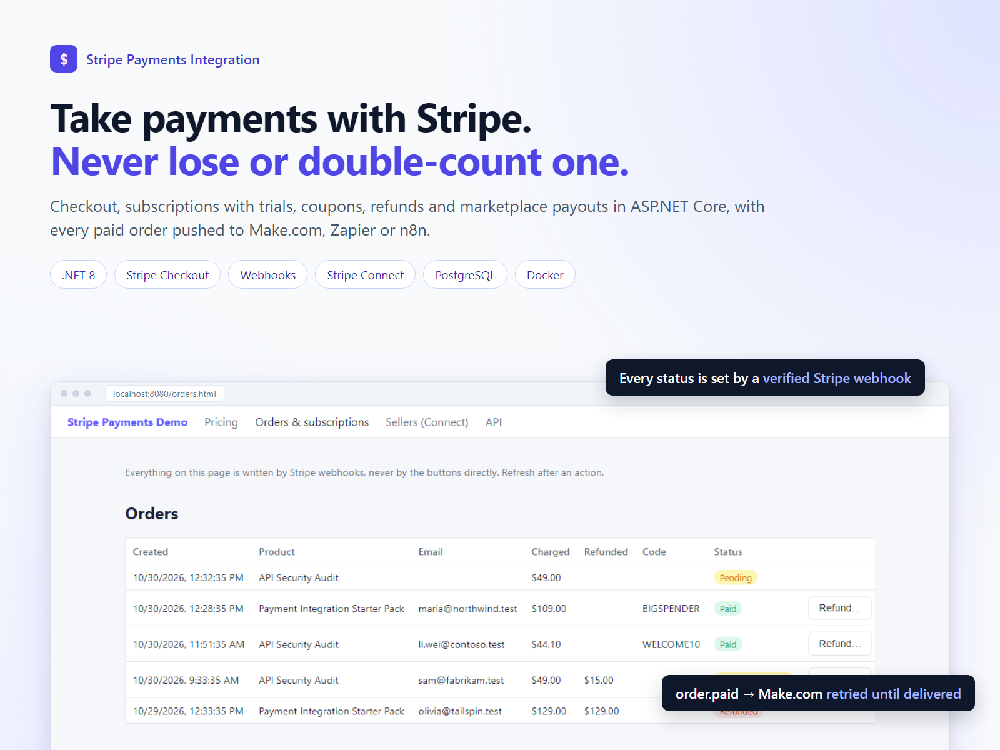
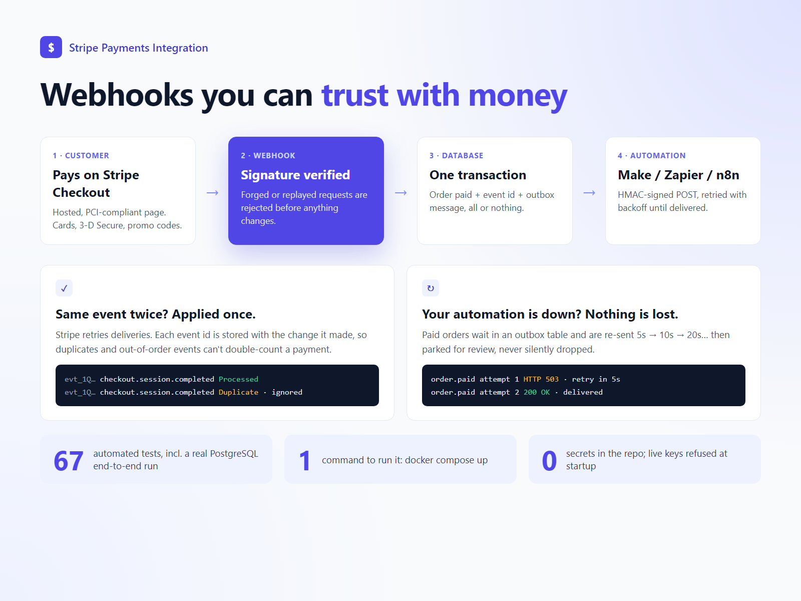
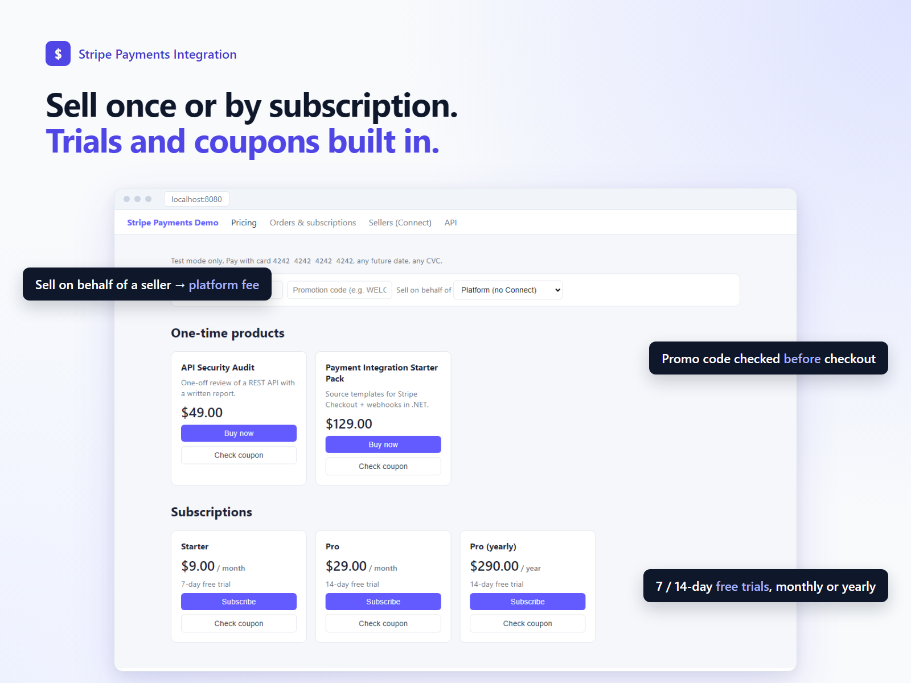
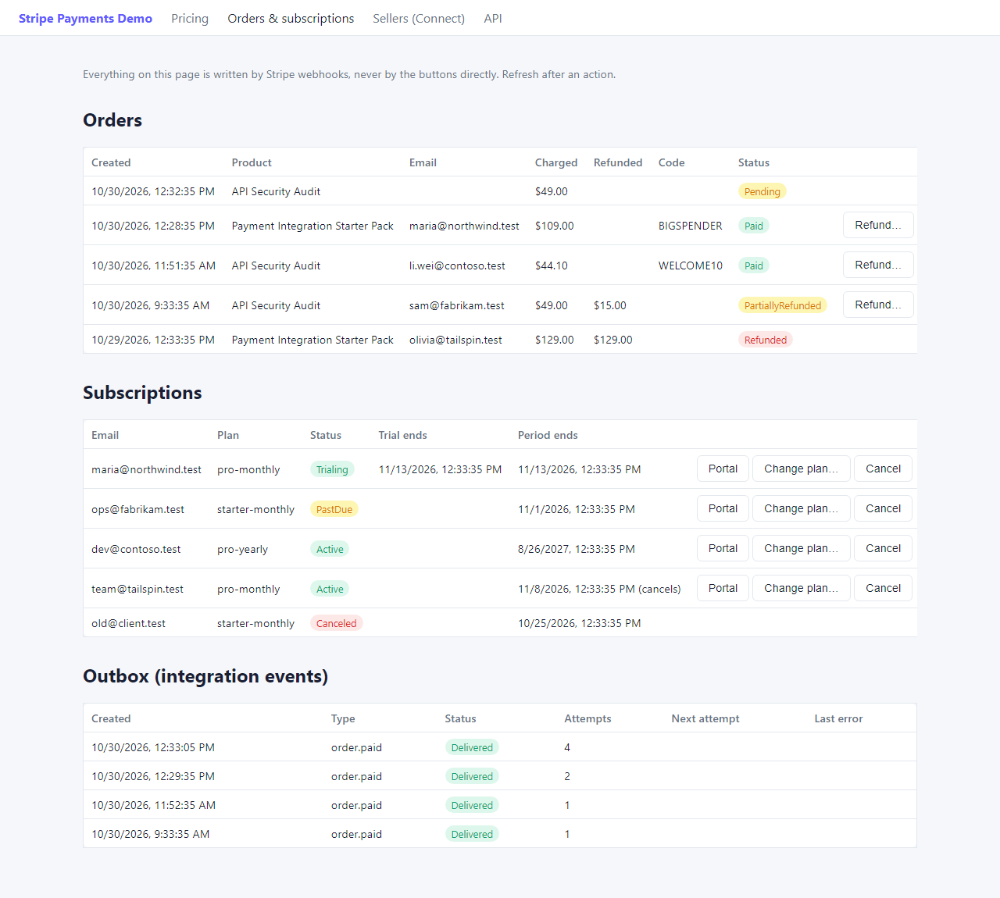
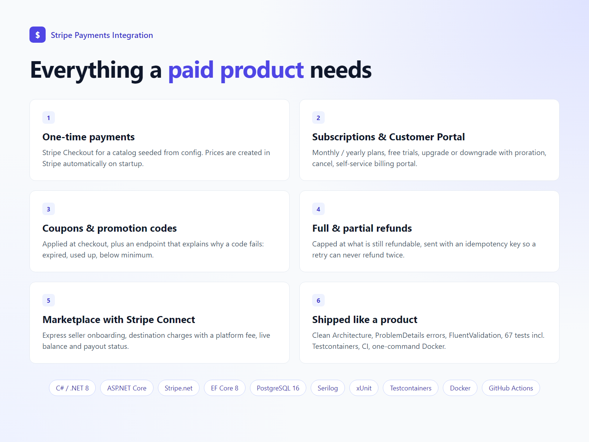
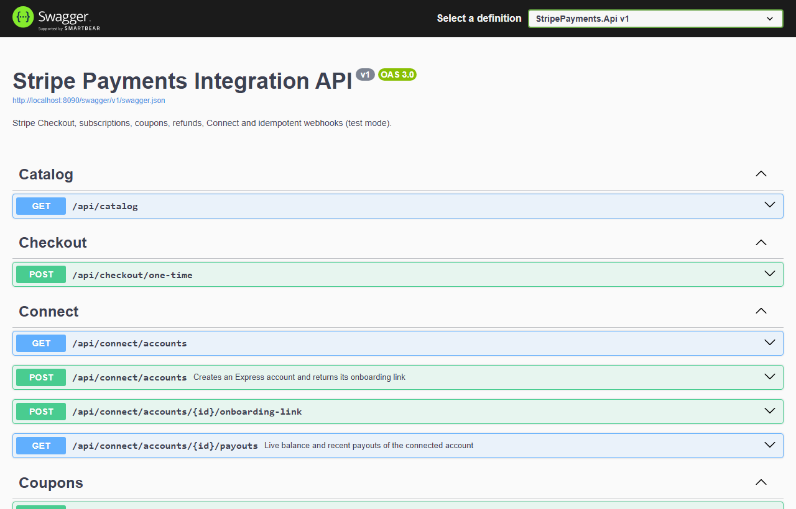
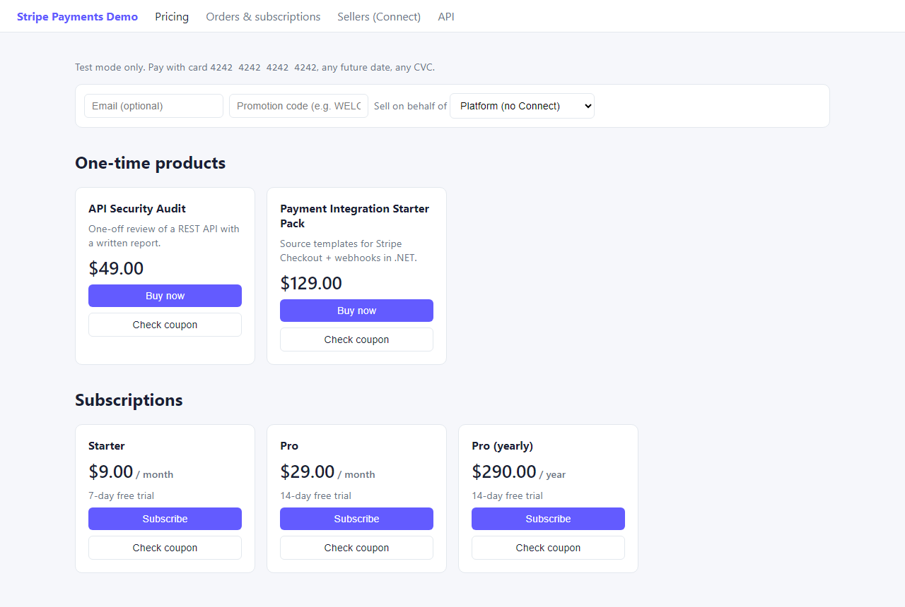
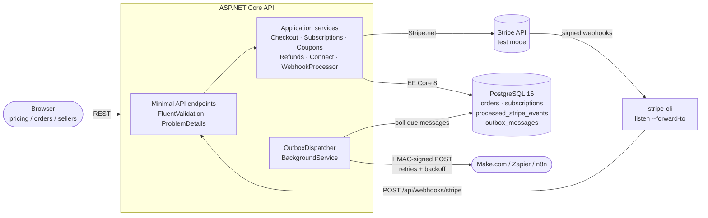
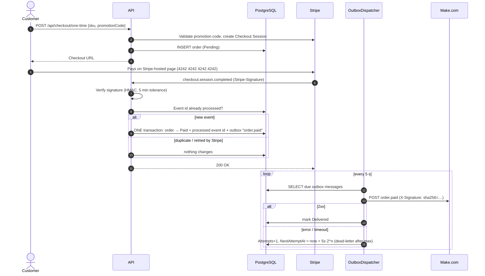

# dotnet-stripe-payments-integration

[](https://github.com/Yusufislamyetkin/dotnet-stripe-payments-integration/actions/workflows/ci.yml)


**A production-style Stripe integration in ASP.NET Core: Checkout, subscriptions, coupons, refunds, Connect marketplaces and reliable webhooks that push paid orders to Make.com, Zapier or n8n.**



---

## Demo

<table>
  <tr>
    <td width="50%"><br><sub><b>Reliable webhooks</b>: verified, applied once, and paid orders retried until your automation accepts them.</sub></td>
    <td width="50%"><br><sub><b>Pricing page</b>: one-time products, monthly/yearly plans with free trials, promo code check, optional Connect seller.</sub></td>
  </tr>
  <tr>
    <td width="50%"><br><sub><b>Orders &amp; subscriptions</b>: every status is written by Stripe webhooks; the outbox shows delivery attempts.</sub></td>
    <td width="50%"><br><sub><b>Feature overview</b>: payments, subscriptions, coupons, refunds, Connect, shipped with tests and CI.</sub></td>
  </tr>
  <tr>
    <td width="50%"><br><sub><b>API</b>: every endpoint documented in Swagger.</sub></td>
    <td width="50%"><br><sub><b>Storefront</b>: plain HTML/JS front end served by the API.</sub></td>
  </tr>
</table>

<sub>Screenshots were taken from the running app with sample data loaded into the local database.</sub>

---

## What this demonstrates

For non-technical readers, this project shows I can:

- **Take payments with Stripe**: one-time purchases and monthly/yearly subscriptions with free trials, using Stripe's hosted, PCI-compliant checkout page.
- **Let customers manage their own billing**: upgrade, downgrade or cancel plans, and open Stripe's Customer Portal to update cards and download invoices.
- **Run discounts**: promotion codes at checkout, plus an endpoint that tells the customer *why* a code doesn't work (expired, minimum amount, used up…).
- **Issue refunds**: full or partial, safely capped so nobody can refund more than was paid.
- **Build a marketplace**: onboard sellers with Stripe Connect Express, split each payment between seller and platform, and show seller payout status.
- **Never lose or double-count a payment**: every Stripe notification is verified, recorded once, and applied exactly once, even if Stripe sends it twice.
- **Connect payments to the rest of your business**: each paid order is reliably sent to your automation tool (Make.com, Zapier, n8n), with retries if that tool is down.
- **Ship it properly**: Docker, automated tests against a real database, CI on every push, health checks and structured logs.

---

## Architecture



Clean Architecture-lite:

| Project | Responsibility |
|---|---|
| `StripePayments.Domain` | Entities and invariants (`Order`, `Subscription`, `Refund`, `ConnectedAccount`, `OutboxMessage`, `ProcessedStripeEvent`). No dependencies. |
| `StripePayments.Application` | Use cases, validators, the webhook processor and outbox processor. Talks to Stripe only through `IStripeGateway`. |
| `StripePayments.Infrastructure` | EF Core + Npgsql, migrations, Stripe.net gateway and webhook parser, HTTP outbox publisher, hosted services. |
| `StripePayments.Api` | Endpoints, error handling, Swagger, health checks, Serilog, static front end. |

### Checkout → webhook → outbox → Make.com



---

## Quick start

Requirements: Docker Desktop and a free Stripe account (test mode).

```bash
git clone https://github.com/Yusufislamyetkin/dotnet-stripe-payments-integration.git && cd dotnet-stripe-payments-integration
cp .env.example .env   # then set STRIPE_SECRET_KEY=sk_test_... from https://dashboard.stripe.com/test/apikeys
docker compose up --build
```

Open <http://localhost:8080>. On startup the API:

1. applies EF Core migrations,
2. seeds products, plans and demo promotion codes from `appsettings.json`,
3. creates the matching Prices/Coupons in **your Stripe test account** (idempotent, by lookup key),
4. and `stripe-cli` starts forwarding webhooks, sharing its signing secret with the API through a volume.

Without a key the app still starts: health checks, Swagger and the UI work, and payment endpoints return a `503` ProblemDetails explaining which setting is missing. Live keys (`sk_live_…`) are rejected at startup.

| URL | |
|---|---|
| <http://localhost:8080> | Pricing page |
| <http://localhost:8080/orders.html> | Orders, subscriptions, outbox status, refund/cancel/plan-change buttons |
| <http://localhost:8080/connect.html> | Seller onboarding (Connect Express) and payout status |
| <http://localhost:8080/swagger> | API |
| <http://localhost:8080/health/ready> | Readiness (PostgreSQL) |
| <http://localhost:8080/api/dev/webhook-sink> | Demo receiver for outbox events (enabled in compose only) |

> Port 5432 or 8080 already taken? `POSTGRES_PORT=5433 API_PORT=8090 docker compose up --build`.
> Customer Portal: in test mode, save the default portal settings once at <https://dashboard.stripe.com/test/settings/billing/portal>.

### Running without Docker

```bash
dotnet user-secrets --project src/StripePayments.Api set "Stripe:SecretKey" "sk_test_..."
dotnet user-secrets --project src/StripePayments.Api set "Stripe:WebhookSecret" "whsec_..."   # printed by `stripe listen`
dotnet run --project src/StripePayments.Api --urls http://localhost:8080
```

PostgreSQL is expected at `localhost:5432` (`docker compose up -d postgres` is enough).

---

## Stripe test cards

Any future expiry date, any CVC, any postal code.

| Card | Result |
|---|---|
| `4242 4242 4242 4242` | Succeeds |
| `4000 0025 0000 3155` | Requires 3D Secure authentication |
| `4000 0000 0000 9995` | Declined (insufficient funds) |
| `4000 0000 0000 0341` | Attaches to the customer but later charges fail: use it on a subscription to see `invoice.payment_failed` |

Demo promotion codes: `WELCOME10` (10% off) and `BIGSPENDER` ($20 off orders of $100+).

## Using stripe-cli

The compose service runs `stripe listen` for you. Outside Docker:

```bash
stripe listen --forward-to localhost:8080/api/webhooks/stripe
```

Useful commands while it runs:

```bash
stripe trigger checkout.session.completed
```

A triggered event has no matching local order, so it is verified, recorded and reported as `Ignored`. Good for checking signatures and logs.

```bash
stripe events resend evt_123
```

Re-delivers a real event: the API answers `{"result":"Duplicate"}` and nothing changes. That is idempotency in action.

---

## API overview

| Method | Path | Notes |
|---|---|---|
| GET | `/api/catalog` | Products and plans |
| POST | `/api/checkout/one-time` | `{ sku, email?, promotionCode?, connectedAccountId? }` → Checkout URL |
| POST | `/api/subscriptions/checkout` | `{ planCode, email?, promotionCode? }`, trial from plan config |
| GET | `/api/subscriptions` | Synced from webhooks |
| POST | `/api/subscriptions/{id}/change-plan` | Upgrade/downgrade with proration (202) |
| POST | `/api/subscriptions/{id}/cancel` | `{ atPeriodEnd: true }` (202) |
| POST | `/api/subscriptions/{id}/portal` | Customer Portal link |
| POST | `/api/coupons/validate` | `{ code, sku | planCode }` → discount, final price or reason |
| GET | `/api/orders`, `/api/orders/{id}` | |
| POST | `/api/orders/{id}/refunds` | `{ amount?, reason? }`, no amount = full refund (202) |
| POST | `/api/connect/accounts` | Create Express account + onboarding link |
| POST | `/api/connect/accounts/{id}/onboarding-link` | Fresh link (links expire) |
| GET | `/api/connect/accounts/{id}/payouts` | Live balance and recent payouts |
| GET | `/api/outbox` | Integration events and delivery status |
| POST | `/api/webhooks/stripe` | Stripe webhook receiver |

Handled webhook events: `checkout.session.completed`, `invoice.paid`, `invoice.payment_failed`, `customer.subscription.created/updated/deleted`, `charge.refunded`, `account.updated`. All errors are RFC 7807 ProblemDetails; validation errors list the failing fields.

## Integrations (Make.com / Zapier / n8n)

Set `OUTBOX_WEBHOOK_URL` in `.env` to your scenario's webhook URL. See [`integrations/`](integrations/) for the payload format, the HMAC signature scheme, an example **Make.com blueprint** (webhook → Google Sheets row) and short Zapier and n8n setups.

---

## Folder structure

```text
.
├── src/
│   ├── StripePayments.Domain/          # Entities + invariants, no dependencies
│   ├── StripePayments.Application/     # Use cases, validators, webhook + outbox processors
│   │   ├── Checkout/  Subscriptions/  Coupons/  Refunds/  Connect/
│   │   ├── Webhooks/                   # Event records + idempotent WebhookProcessor
│   │   └── Outbox/                     # Retry policy, HMAC signature, OutboxProcessor
│   ├── StripePayments.Infrastructure/
│   │   ├── Persistence/                # DbContext, configurations, migrations
│   │   ├── Stripe/                     # Stripe.net gateway + signature-verifying event parser
│   │   ├── Outbox/                     # HTTP publisher + BackgroundService dispatcher
│   │   └── Startup/                    # Migrate, seed, sync catalog to Stripe
│   └── StripePayments.Api/
│       ├── Endpoints/  Errors/
│       └── wwwroot/                    # Plain HTML/JS front end
├── tests/
│   ├── Shared/                         # Stripe event builder/signer, fake gateway
│   ├── StripePayments.UnitTests/       # 63 tests
│   └── StripePayments.IntegrationTests/# Testcontainers PostgreSQL, end-to-end flow
├── integrations/                       # Make.com blueprint, Zapier/n8n notes
├── docker-compose.yml  Dockerfile  .env.example
└── .github/workflows/ci.yml
```

---

## Design decisions

**State changes come from webhooks only.** The success page and the API's own Stripe calls never mark anything as paid, refunded or canceled. Stripe is the source of truth and webhooks are how it reports facts; a redirect can be skipped, replayed or faked. Commands (`cancel`, `change-plan`, `refund`) ask Stripe to act and return `202 Accepted`; the database follows when the event arrives.

**Idempotency via stored event ids.** Stripe delivers *at least once*, so the same event can arrive twice, or two copies can arrive at the same time. Each handled event id goes into `processed_stripe_events` (primary key) **in the same `SaveChanges` call** as the state change. A replay is skipped up front; a concurrent duplicate fails on the primary key and is reported as `Duplicate`, so its changes are never committed. Domain methods are idempotent as well (`MarkPaid` on a paid order is a no-op), and subscription snapshots older than the last applied one are ignored, so out-of-order delivery is safe.

**Why a transactional outbox.** Calling Make.com directly from the webhook handler creates two failure modes: the DB commit succeeds but the HTTP call fails (the automation never runs), or the HTTP call succeeds but the commit fails (the automation runs for a payment we didn't record). Writing the `order.paid` message to `outbox_messages` in the same transaction as the order update makes the two atomic. A `BackgroundService` delivers it later with exponential backoff (5s, 10s, 20s… capped at 1h), dead-letters after `MaxAttempts`, and signs each request with HMAC-SHA256 over `timestamp.body` so the receiver can verify origin and reject replays. Delivery is at-least-once; receivers de-duplicate on `X-Event-Id`.

**Signature verification on the raw body.** The webhook endpoint reads the body as a string before any JSON binding, because re-serialised JSON would not match Stripe's signature. Events are then mapped to small provider-neutral records, so the processor is unit-tested without Stripe.

**Catalog as configuration, synced by lookup key.** Products, plans and demo coupons live in `appsettings.json`. On startup they are created in Stripe if missing. Prices are immutable in Stripe, so the lookup key includes amount, currency and interval: changing a price creates a new one instead of silently editing history.

**Safe refunds.** The refundable amount is capped by both the webhook-confirmed refunded total and refunds already requested but not yet confirmed, and the local refund id is sent as Stripe's `Idempotency-Key`, so a retried request cannot refund twice.

**No secrets in the repo.** Keys come from user-secrets or `.env` (git-ignored). Only test keys are accepted. Missing configuration produces a clear `503` instead of a stack trace.

---

## Tests

```bash
dotnet test
```

- **63 unit tests**: webhook handling, idempotency (replayed events, a second event for an already-paid order, out-of-order subscription events), signature verification (tampering, wrong secret, old timestamp), coupon rules, refund caps, Connect fees, outbox retry/backoff/dead-letter and HMAC signing.
- **4 integration tests** (Testcontainers PostgreSQL, Docker required): the real API from checkout to a signed webhook, replay, order paid, outbox delivery that fails once and succeeds on retry with a verified signature, plus forged signatures, validation problems and missing-key behaviour.

Automated tests replace the outbound Stripe API with a fake; webhook signatures go through the real Stripe.net verification. Calls to the live Stripe test API are exercised manually with the quick start above.

---

## Deploy

The image is a standard ASP.NET Core container listening on port `8080`. It needs a PostgreSQL connection string and the environment variables below; migrations run on startup.

| Variable | Example |
|---|---|
| `ConnectionStrings__Postgres` | `Host=…;Database=…;Username=…;Password=…;SSL Mode=Require` |
| `App__PublicBaseUrl` | `https://your-app.onrender.com` |
| `Stripe__SecretKey` | `sk_test_…` |
| `Stripe__WebhookSecret` | `whsec_…` from the dashboard endpoint (not stripe-cli) |
| `Outbox__WebhookUrl` / `Outbox__SigningSecret` | Your Make.com URL / a long random string |

In the Stripe dashboard (test mode) add a webhook endpoint `https://<host>/api/webhooks/stripe` with the events listed under *API overview*, and for Connect also enable events from connected accounts.

**Render:** create a PostgreSQL instance, then a *Web Service* from this repo with runtime *Docker*. Paste the internal connection string and the variables above, and set the health check path to `/health/ready`.

**Azure Container Apps:**

```bash
az containerapp up --name stripe-payments --resource-group rg-payments --location westeurope --source . --ingress external --target-port 8080
az containerapp secret set -n stripe-payments -g rg-payments --secrets pg="Host=...;SSL Mode=Require" stripe-key="sk_test_..." stripe-whsec="whsec_..."
az containerapp update -n stripe-payments -g rg-payments --set-env-vars ConnectionStrings__Postgres=secretref:pg Stripe__SecretKey=secretref:stripe-key Stripe__WebhookSecret=secretref:stripe-whsec App__PublicBaseUrl=https://<app-fqdn>
```

Use Azure Database for PostgreSQL Flexible Server, store secrets as Container App secrets, and keep `minReplicas=1` (see the outbox note below).

This repository contains no infrastructure-as-code; the steps above are the manual setup.

---

## Roadmap / known limitations

- The outbox dispatcher assumes **one API instance**. Scaling out needs row locking (`SELECT … FOR UPDATE SKIP LOCKED`) or a lease column.
- No authentication: the demo endpoints are open. A real deployment needs auth on everything except the webhook receiver.
- No admin endpoint to replay dead-lettered outbox messages yet (visible in `GET /api/outbox`).
- Only `order.paid` is published to the outbox; subscription lifecycle events could follow the same pattern.
- The concurrent-duplicate path (two copies of one event committing at the same time) relies on the primary key and is not covered by an automated test yet.
- Checkout Sessions that expire (`checkout.session.expired`) leave the order `Pending`.
- Connect uses destination charges only (no separate charges and transfers).
- A GIF of a live checkout against Stripe for the demo section.

---

**Need this for your product? [Contact me on Upwork](https://www.upwork.com/freelancers/~your-profile-id)**: Stripe, payments and .NET backend integrations.
